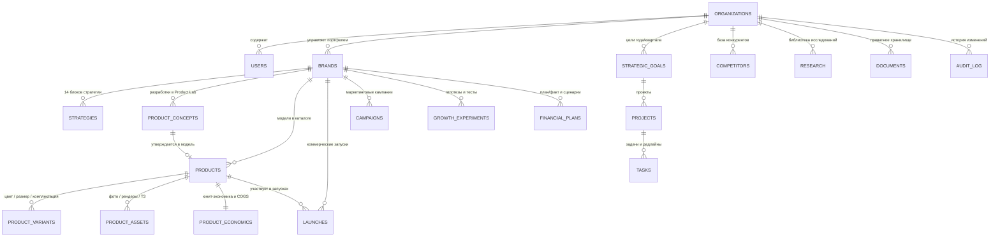

# Схема базы данных и архитектура RLS (п. 17, 26 ТЗ)

Полные SQL-миграции расположены в:
- [`supabase/migrations/0001_initial_schema.sql`](../supabase/migrations/0001_initial_schema.sql) — таблицы, типы, индексы, триггеры `updated_at` и серверная функция расчёта юнит-экономики `public.calculate_unit_economics`.
- [`supabase/migrations/0002_rls_policies_and_seed.sql`](../supabase/migrations/0002_rls_policies_and_seed.sql) — функции проверки ролей (`SECURITY DEFINER`), политики Row-Level Security (RLS) и стартовые данные.

---

## 1. Иерархия сущностей (п. 17 ТЗ)

---

## 2. Ключевые архитектурные правила
1. **Разделение сущностей:**
   - `product_concepts` — проект разработки в `Product Lab` (включая галерею версий дизайна и трёхъязычное ТЗ `tech_pack` в формате JSONB `zh / en / ru`).
   - `products` — утверждённая или существующая модель в `Product Catalog`.
   - `product_variants` — конкретный SKU варианта (цвет, размер `S–XXL`, комплектация `1 шт.` / `Набор 3 шт.`, остаток).
   - `launches` — коммерческий запуск с 10 этапами (`концепция → дизайн → образец → тест → производство → логистика → карточки → маркетинг → продажи → анализ`).
2. **Денежные типы и точность:** все финансовые показатели хранятся в `NUMERIC(14,2)` с кодом валюты (`RUB`, `USD`, `CNY`). Отсутствие фактических данных за будущие периоды хранится как `NULL` (отображается как «Нет данных», а не `0`).
3. **Мягкое архивирование:** флаги `is_archived BOOLEAN NOT NULL DEFAULT false` и `archived_at TIMESTAMPTZ` позволяют архивировать объекты без нарушения внешних ключей и связей.
4. **Матрица ролей и RLS (п. 15 ТЗ):**
   - `Owner` / `Admin` — полный доступ к организации, редактирование утверждённых версий стратегий, управление пользователями.
   - `Manager` — редактирование назначенных брендов (`assigned_brand_ids`), доступ к финансам и себестоимости определяется отдельными флагами `can_view_finance` и `can_view_cost_price`.
   - `Viewer` — чтение разрешённых разделов без права модификации.
   - `Partner` — доступ строго к производственным разделам (`Product Lab`, `Product Catalog`, `Launch Calendar`, производственные документы) без доступа к стратегии и финансам.
